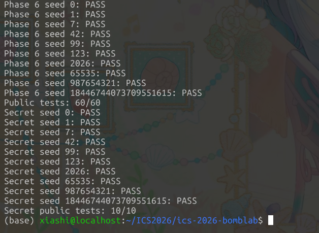

## Phase 01:

- 执行objdump命令得到汇编代码

`objdump -d --disassemble=phase_01 ./bomb`


```assembly

0000000000402090 <phase_01>:
  402090:       endbr64
  402094:       push   %rbp
  402095:       mov    %rsp,%rbp
  402098:       push   %r12
  40209a:       mov    %rsi,%r12
  40209d:       mov    $0x1,%esi
  4020a2:       push   %rbx
  4020a3:       mov    %rdi,%rbx
  4020a6:       sub    $0x10,%rsp
  4020aa:       call   402c80 <valid_u32_fields>
  4020af:       test   %al,%al
  4020b1:       jne    4020c0 <phase_01+0x30>
  4020b3:       add    $0x10,%rsp
  4020b7:       xor    %eax,%eax
  4020b9:       pop    %rbx
  4020ba:       pop    %r12
  4020bc:       pop    %rbp
  4020bd:       ret
  4020be:       xchg   %ax,%ax
  4020c0:       xor    %eax,%eax
  4020c2:       lea    -0x14(%rbp),%rdx
  4020c6:       mov    $0x403189,%esi
  4020cb:       mov    %rbx,%rdi
  4020ce:       call   4011e0 <__isoc99_sscanf@plt>
  4020d3:       cmp    $0x1,%eax
  4020d6:       jne    4020b3 <phase_01+0x23>
  4020d8:       mov    %r12,%rdi
  4020db:       call   402050 <p1_compute>
  4020e0:       cmp    %eax,-0x14(%rbp)
  4020e3:       sete   %al
  4020e6:       add    $0x10,%rsp
  4020ea:       pop    %rbx
  4020eb:       pop    %r12
  4020ed:       pop    %rbp
  4020ee:       ret
```


- 分析函数传参与寄存器值，查看第一次函数调用

  >```c
  >grep -rn "valid_u32_fields" --include=*.h .
  >//在仓库中搜索函数声明，在phase_support.c中找到源码
  >
  >bool valid_u32_fields(const char *input, size_t count) {
  >    const unsigned char *cursor = (const unsigned char *)input;
  >    for (size_t i = 0; i < count; ++i) {
  >        while (isspace(*cursor)) ++cursor;	//跳过前导空白
  >        if (*cursor < '0' || *cursor > '9') return false;  
  >        //第一个非空白必须是数字
  >        uint32_t value = 0;
  >        do {
  >            uint32_t digit = *cursor - '0';
  >            if (value > (UINT32_MAX - digit) / 10) return false;
  >            value = value * 10 + digit;
  >            ++cursor;
  >        } while (*cursor >= '0' && *cursor <= '9');	//遇到不是数字就停止
  >        if (*cursor && !isspace(*cursor)) return false;	//字段之间必须是空白
  >    }
  >    while (isspace(*cursor)) ++cursor;	//跳过尾部空白
  >    return *cursor == '\0';
  >}
  >//结合汇编代码中寄存器的传值，count = 1， para1的含义与const char *input 相对应
  >
  >//分析函数功能：格式校验（检查input字符串是否为count个合法uint32位十进制整数，整数之间用空格分隔）因此本题中的input就是一个整数
  >
  >//结合汇编代码可知，这里返回true，会直接跳到4020c0
  >```


- 第二次函数调用

  > 这里调用的是sscanf这一libc库函数，可知它的签名为
  > `int sscanf(const char *str, const char *format, ...);`
  > 根据寄存器存值可知：input(%rdi)对应的是const char * str（由第一次函数调用知其含义），此处传入的format为0x403189(%esi) 以及 rbp - 0x14（%rdx）；这里的三个参数的含义分别为源字符串，格式串和输出地址。
  >
  > 据此，可知需要取得后面两个地址对应存放的数据。
  > 前者可以通过静态分析，利用objdump直接查看对应.rodata段的数据
  > ` objdump -s -j .rodata --start-address=0x403189 --stop-address=0x403190 ./bomb`
  >
  > 得到` 403189 257500 2d2d7365                      %u.--se`
  > 而由于栈地址每次运行时不固定，输出地址需要使用gdb进行动态调试：
  > 在函数即将返回时设置断点：`break *0x4020d3`
  >
  > 然后运行，使用`input = 123`
  > ``p/d $eax`-- 查看sscanf的返回值，为1，表示匹配了1对格式说明符与输出
  > ` x/1uw $rbp-0x14` -- 查看输出地址对应的数据，恰好为先前的input
  >
  > 总之，这里的函数调用把input这一字符串转换成数据存储到栈上，同时验证了前述关于input是一个uint32位十进制整数的判断


- **第三次函数调用**

  > 根据汇编代码中的函数调用进行反汇编`(objdump -d --no-show-raw-insn --disassemble=p1_compute ./bomb)`，发现这里面又存在3个函数调用，再次根据对应地址进行反汇编（`objdump -d --no-show-raw-insn --start-address=0x402020 --stop-address=0x402086 ./bomb`）
  >
  > 得到的这一系列反汇编代码主要涉及到的都是有关参数para2（代码中为x）的运算，恢复成伪C代码为：
  >
  > ```C
  >  uint64_t x = ...;
  >     uint32_t y = ((uint32_t)(x >> 16) + 0x5482 ) ^ ((uint32_t)(x>>32));
  >     uint32_t z = ((uint32_t)(x>>32)^0x393) + 8*(uint32_t)x;
  >     uint32_t result = 3*(z-y) + 0xe00b;
  > ```
  >
  > 接下来通过gdb查看参数para2：
  > `break *0x4020d8`-- 设置断点，之后运行
  > `p/x $r12`-- 查看para2的值，验证其与bomb启动时打印的challenge一致，则确认para2为challenge

- 最后，程序比较result和input的值，若相等，返回1，程序pass；否则返回0，炸弹爆炸。据此可编写defuse函数。

---

## Phase 02:

- 执行objdump命令获取汇编代码

  > `objdump -d --no-show-raw-insn --disassemble=phase_02 ./bomb`

```assembly
00000000004020f0 <phase_02>:
  4020f0:       endbr64
  4020f4:       push   %rbp
  4020f5:       mov    %rsp,%rbp
  4020f8:       push   %r13
  4020fa:       mov    %rsi,%r13
  4020fd:       mov    $0x6,%esi
  402102:       push   %r12
  402104:       mov    %rdi,%r12
  402107:       push   %rbx
  402108:       sub    $0x28,%rsp
  40210c:       call   402c80 <valid_u32_fields>
  402111:       test   %al,%al
  402113:       jne    402128 <phase_02+0x38>
  402115:       xor    %ebx,%ebx
  402117:       lea    -0x18(%rbp),%rsp
  40211b:       mov    %ebx,%eax
  40211d:       pop    %rbx
  40211e:       pop    %r12
  402120:       pop    %r13
  402122:       pop    %rbp
  402123:       ret
  402124:       nopl   0x0(%rax)
  402128:       mov    %eax,%ebx
  40212a:       lea    -0x2c(%rbp),%rax
  40212e:       lea    -0x3c(%rbp),%rcx
  402132:       mov    $0x40317a,%esi
  402137:       push   %rax
  402138:       lea    -0x30(%rbp),%rax
  40213c:       lea    -0x40(%rbp),%rdx
  402140:       mov    %r12,%rdi
  402143:       push   %rax
  402144:       lea    -0x34(%rbp),%r9
  402148:       lea    -0x38(%rbp),%r8
  40214c:       xor    %eax,%eax
  40214e:       call   4011e0 <__isoc99_sscanf@plt>
  402153:       pop    %rdx
  402154:       pop    %rcx
  402155:       cmp    $0x6,%eax
  402158:       jne    402115 <phase_02+0x25>
  40215a:       lea    0x0(%r13,%r13,1),%eax
  40215f:       mov    -0x40(%rbp),%esi
  402162:       and    $0x1e,%eax
  402165:       add    $0x15,%eax
  402168:       cmp    %eax,%esi
  40216a:       jne    402115 <phase_02+0x25>
  40216c:       mov    $0x17,%ecx
  402171:       mov    $0x1,%edx
  402176:       mov    %r13,%rax
  402179:       shr    %cl,%rax
  40217c:       and    $0x3f,%eax
  40217f:       add    %esi,%eax
  402181:       mov    -0x40(%rbp,%rdx,4),%esi
  402185:       xor    %edx,%eax
  402187:       cmp    %eax,%esi
  402189:       jne    402115 <phase_02+0x25>
  40218b:       add    $0x1,%rdx
  40218f:       add    $0x3,%ecx
  402192:       cmp    $0x6,%rdx
  402196:       jne    402176 <phase_02+0x86>
  402198:       jmp    402117 <phase_02+0x27>
```

- 分析

  > 传参与 Phase 01 同理：序言中 `r12 = input`，`r13 = challenge`。
  > `4020fd: mov $0x6,%esi` 后调用 `valid_u32_fields(input, 6)`，同时结合sscanf函数可知 input 由 **6 个** uint32 整数组成。
  >
  > sscanf 之后（40215a 起）是判定逻辑，记 challenge 为 x、6 个整数为 a[0..5]。
  > 
  > 
  >
  > 第一部分校验 a[0]：
  > 
  >```assembly
  > 40215a: lea 0x0(%r13,%r13,1),%eax   
  > 40215f: mov -0x40(%rbp),%esi        ; esi = a[0]
  > 402162: and $0x1e,%eax             
  > 402165: add $0x15,%eax              ; eax = (2x & 0x1e) + 0x15
  > 402168: cmp %eax,%esi               
  > 40216a: jne 402115
  > ```
  > 
  >第二部分是一个循环，逐次校验 a[1] 到 a[5]：
  > 
  >```assembly
  > 40216c: mov $0x17,%ecx              ; ecx = 移位量 shift，初值 0x17
  > 402171: mov $0x1,%edx               ; edx = 下标 i，初值 1
  > 402176: mov %r13,%rax               
  > 402179: shr %cl,%rax                ; rax = x >> shift
  > 40217c: and $0x3f,%eax              ; 取低 6 位
  > 40217f: add %esi,%eax               ; eax += a[i-1]
  > 402181: mov -0x40(%rbp,%rdx,4),%esi ; esi = a[i]
  > 402185: xor %edx,%eax               ; eax ^= i
  > 402187: cmp %eax,%esi               
  > 402189: jne 402115
  > 40218b: add $0x1,%rdx               ; i++
  > 40218f: add $0x3,%ecx               ; shift += 3
  > 402192: cmp $0x6,%rdx
  > 402196: jne 402176                  ; 循环 5 次
  > ```
  
- 恢复出的计算关系（伪c代码）：

  ```c
  uint32_t a[6];
  a[0] = ((uint32_t)(2 * x) & 0x1e) + 0x15;
  unsigned shift = 0x17;
  for (int i = 1; i < 6; ++i) {
      a[i] = (((uint32_t)(x >> shift) & 0x3f) + a[i - 1]) ^ (uint32_t)i;
      shift += 3;
  }
  ```

  ---

## Phase 03

- 反汇编 phase_03 主体

  > `objdump -d --no-show-raw-insn --disassemble=phase_03 ./bomb`

```assembly
00000000004022b0 <phase_03>:
  4022b0:       endbr64
  4022b4:       push   %rbp
  4022b5:       mov    %rsp,%rbp
  4022b8:       push   %r12
  4022ba:       mov    %rsi,%r12        ; r12 = challenge
  4022bd:       mov    $0x2,%esi        ; count = 2
  4022c2:       push   %rbx
  4022c3:       mov    %rdi,%rbx        ; rbx = input
  4022c6:       sub    $0x10,%rsp
  4022ca:       call   402c80 <valid_u32_fields>
  4022cf:       test   %al,%al
  4022d1:       jne    4022e0
  ; ... 失败返回 ...
  4022e0:       xor    %eax,%eax
  4022e2:       lea    -0x14(%rbp),%rcx  ; &a[1]
  4022e6:       lea    -0x18(%rbp),%rdx  ; &a[0]
  4022ea:       mov    $0x403186,%esi    ; 格式串地址
  4022ef:       mov    %rbx,%rdi
  4022f2:       call   4011e0 <__isoc99_sscanf@plt>
  4022f7:       cmp    $0x2,%eax         ; 须匹配 2 个
  4022fa:       jne    4022d3
  4022fc:       mov    %r12d,%edi        ; edi = challenge 低32位
  402301:       and    $0x7,%edi         ; edi = challenge & 7
  402304:       cmp    %edi,-0x18(%rbp)  ; a[0] 必须等于 challenge & 7
  402307:       jne    4022d5
  402309:       mov    %r12,%rax
  40230c:       mov    %r12,%rsi
  40230f:       shr    $0x3,%rax         ; rax = challenge >> 3
  402313:       shr    $0x20,%rsi        ; rsi = challenge >> 32
  402317:       xor    %eax,%esi         ; esi = (challenge>>3) ^ (challenge>>32)
  402319:       call   402250 <p3_dispatch>
  40231e:       cmp    %eax,-0x14(%rbp)  ; a[1] 必须等于 dispatch 返回值
  402321:       sete   %al
  402324:       jmp    4022d5
```

- 分析

  > 格式串 `0x403186` 静态查询（`objdump -s -j .rodata --start-address=0x403186 --stop-address=0x40318c ./bomb`）得 `"%u %u"`，input 为 2 个整数。
  > `a[0]` 直接等于 `challenge & 7`；`a[1]` 等于 `p3_dispatch(index, y)` 的返回值，其中 `index = challenge & 7`，`y = (uint32_t)(challenge>>3) ^ (uint32_t)(challenge>>32)`。
  >
  > `p3_dispatch` 是一个 switch 跳转表（`objdump -d --no-show-raw-insn --start-address=0x402250 --stop-address=0x402260 ./bomb`）：
  >
  > ```assembly
  > 402254: mov %edi,%eax              ; eax = index
  > 402256: mov %esi,%edi              ; edi = y
  > 402258: cmp $0x7,%eax
  > 40225b: ja  4022a5                 ; index > 7 走 default，返回 0
  > 40225d: notrack jmp *0x405820(,%rax,8)  ; 间接跳转：table[index] → case 入口
  > ```
  >
  > 跳转表位于 `.rodata` 的 `0x405820`，共 8 条 64 位地址，gdb 查看（`x/8xg 0x405820`）：
  >
  > ```
  > 索引 0: 0x402278    索引 1: 0x402280
  > 索引 2: 0x402288    索引 3: 0x402290
  > 索引 4: 0x402298    索引 5: 0x4022a0
  > 索引 6: 0x402268    索引 7: 0x402270
  > ```
  >
  > 每个表项指向一个 jmp 跳板，再跳到对应的 `p3_case_N`（`objdump -d --no-show-raw-insn --start-address=0x402268 --stop-address=0x4022b0 ./bomb`）：
  >
  > ```assembly
  > 402268: jmp 4021a0 <p3_case_0>     ; 索引 6
  > 402270: jmp 402220 <p3_case_6>     ; 索引 7
  > 402278: jmp 4021e0 <p3_case_3>     ; 索引 0
  > 402280: jmp 402240 <p3_case_7>     ; 索引 1
  > 402288: jmp 4021b0 <p3_case_1>     ; 索引 2
  > 402290: jmp 4021d0 <p3_case_2>     ; 索引 3
  > 402298: jmp 4021f0 <p3_case_4>     ; 索引 4
  > 4022a0: jmp 402200 <p3_case_5>     ; 索引 5
  > ```
  >
  > **注意：索引和 case 编号不是一一对应的**，表项的物理顺序由编译器决定，直接按函数名里的数字对号入座会得到错误答案。
  >
  > 8 个 case 函数的反汇编（`objdump -d --no-show-raw-insn --start-address=0x4021a0 --stop-address=0x402250 ./bomb`，每个都很短）：
  >
  > ```assembly
  > 00000000004021a0 <p3_case_0>:            ; 索引 6
  >   4021a4: mov %edi,%eax
  >   4021a6: shr $1,%edi
  >   4021a8: xor $0x8ab8,%eax
  >   4021ad: add %edi,%eax                  ; (y>>1) + (y ^ 0x8ab8)
  >
  > 00000000004021b0 <p3_case_1>:            ; 索引 2
  >   4021b4: lea 0x0(,%rdi,4),%eax
  >   4021bb: xor $0x4a9e,%eax               ; 4*y ^ 0x4a9e
  >
  > 00000000004021d0 <p3_case_2>:            ; 索引 3
  >   4021d4: lea 0x6dbf(%rdi,%rdi,4),%eax   ; 5*y + 0x6dbf
  >
  > 00000000004021e0 <p3_case_3>:            ; 索引 0
  >   4021e4: lea 0xadd1(%rdi,%rdi,2),%eax   ; 3*y + 0xadd1
  >
  > 00000000004021f0 <p3_case_4>:            ; 索引 4
  >   4021f4: lea 0xb823(%rdi,%rdi,2),%eax   ; 3*y + 0xb823
  >
  > 0000000000402200 <p3_case_5>:            ; 索引 5
  >   402204: mov %edi,%eax
  >   402206: shr $0x2,%edi
  >   402209: xor $0xc191,%eax
  >   40220e: add %edi,%eax                  ; (y>>2) + (y ^ 0xc191)
  >
  > 0000000000402220 <p3_case_6>:            ; 索引 7
  >   402224: lea 0x0(,%rdi,4),%eax
  >   40222b: xor $0x37b8,%eax               ; 4*y ^ 0x37b8
  >
  > 0000000000402240 <p3_case_7>:            ; 索引 1
  >   402244: lea 0x49e7b(%rdi,%rdi,4),%eax  ; 5*y + 0x49e7b
  > ```

- 恢复出的计算关系（伪代码）：

  ```c
  uint32_t index = (uint32_t)challenge & 7;
  uint32_t y = (uint32_t)(challenge >> 3) ^ (uint32_t)(challenge >> 32);
  uint32_t result;
  switch (index) {
  case 0: result = 3 * y + 0xadd1;          break;
  case 1: result = 5 * y + 0x49e7b;         break;
  case 2: result = 4 * y ^ 0x4a9e;          break;
  case 3: result = 5 * y + 0x6dbf;          break;
  case 4: result = 3 * y + 0xb823;          break;
  case 5: result = (y >> 2) + (y ^ 0xc191); break;
  case 6: result = (y >> 1) + (y ^ 0x8ab8); break;
  default: result = 4 * y ^ 0x37b8;         break;
  }
  
  ```

  ---

## Phase 04

- 反汇编 phase_04 主体

  > `objdump -d --no-show-raw-insn --disassemble=phase_04 ./bomb`

```assembly
00000000004023a0 <phase_04>:
  4023a0:       endbr64
  4023a4:       push   %rbp
  4023a5:       mov    %rsp,%rbp
  4023a8:       push   %r12
  4023aa:       mov    %rsi,%r12        ; r12 = challenge
  4023ad:       mov    $0x1,%esi        ; count = 1
  4023b2:       push   %rbx
  4023b3:       mov    %rdi,%rbx        ; rbx = input
  4023b6:       sub    $0x10,%rsp
  4023ba:       call   402c80 <valid_u32_fields>
  4023bf:       test   %al,%al
  4023c1:       jne    4023d0
  ; ... 失败返回 ...
  4023d0:       xor    %eax,%eax
  4023d2:       lea    -0x14(%rbp),%rdx  ; 输出槽地址
  4023d6:       mov    $0x403189,%esi    ; 格式串 "%u"（同 Phase 01）
  4023db:       mov    %rbx,%rdi
  4023de:       call   4011e0 <__isoc99_sscanf@plt>
  4023e3:       cmp    $0x1,%eax
  4023e6:       jne    4023c3
  4023e8:       mov    %r12,%rcx         ; rcx = challenge
  4023eb:       mov    %r12,%rax         ; rax = challenge
  4023ee:       mov    %r12d,%edi        ; edi = challenge 低32位
  4023f1:       xor    %esi,%esi         ; esi = 0
  4023f3:       shr    $0x20,%rax        ; rax = challenge >> 32
  4023f7:       shr    $0x7,%rcx         ; rcx = challenge >> 7
  4023fb:       and    $0x7f,%edi        ; edi = challenge & 0x7f
  4023fe:       mov    $0x7f,%edx        ; edx = 0x7f
  402403:       xor    %eax,%ecx         ; ecx = (challenge>>32) ^ (challenge>>7)
  402405:       call   402330 <p4_walk>
  40240a:       cmp    %eax,-0x14(%rbp)  ; 输入值 == 返回值
  40240d:       sete   %al
  402410:       add    $0x10,%rsp
  ; ... 返回 ...
```

- 分析

  > 格式串同 Phase 01（`0x403189` → `"%u"`），input 为 1 个整数。
  > 调用 `p4_walk` 的四个参数：`edi = challenge & 0x7f`（target），`esi = 0`（lo），`edx = 0x7f`（hi），`ecx = (challenge>>32) ^ (challenge>>7)`（key）。
  >
  > 递归函数 `p4_walk`（`objdump -d --no-show-raw-insn --disassemble=p4_walk ./bomb`）：
  >
  > ```assembly
  > 402334: mov %edi,%eax            ; eax = target（保存原始值）
  > 402336: mov %edx,%edi            
  > 402338: sub %esi,%edi           
  > 40233a: shr $1,%edi             
  > 40233c: add %esi,%edi            ; edi = mid = ((hi-lo)>>1) + lo
  > 40233e: cmp %eax,%edi            ; mid == target ?
  > 402340: je  402390               ; → base case
  >
  > ; 递归路径（建栈帧保存 temp）
  > 402347: lea (%rdi,%rcx,1),%ebx   ; ebx = mid + key（temp）
  > 40234e: cmp %edi,%eax            ; target < mid ?
  > 402350: jb  402370               ; → 左分支
  >
  > ; 右分支（target > mid）
  > 402352: lea 0x1(%rdi),%esi       ; lo = mid + 1
  > 402355: mov %eax,%edi            ; target 不变
  > 402357: call 402330 <p4_walk>    ; 递归
  > 40235c: lea (%rax,%rax,2),%eax   ; result * 3
  > 40235f: xor %ebx,%eax            ; ^ temp
  > 402365: leave
  > 402366: xor $0x5,%eax            ; ^ 0x5
  > 402369: ret
  >
  > ; 左分支（target < mid）
  > 402370: lea -0x1(%rdi),%edx      ; hi = mid - 1
  > 402373: mov %eax,%edi            ; target 不变
  > 402375: call 402330 <p4_walk>    ; 递归
  > 40237a: lea (%rax,%rax,2),%eax   ; result * 3
  > 40237d: xor %ebx,%eax            ; ^ temp
  > 402383: leave
  > 402384: xor $0x1,%eax            ; ^ 0x1
  > 402387: ret
  >
  > ; base case
  > 402390: lea 0x5b(%rdi),%eax      ; eax = mid + 0x5b
  > 402393: xor %ecx,%eax            ; ^ key
  > 402395: ret
  > ```
  >
  > 这是一个**二分查找式的递归**：每次取 `mid = ((hi-lo)>>1) + lo` 与 target 比较，向对应半区递归，直到 mid == target。每层递归返回时乘 3、异或 `mid + key`、再异或一个常数（左分支 `0x1`，右分支 `0x5`）。

- 恢复出的计算关系（伪代码）：

  ```c
  uint32_t p4_walk(uint32_t target, uint32_t lo, uint32_t hi, uint32_t key) {
      uint32_t mid = ((hi - lo) >> 1) + lo;
      if (mid == target)
          return (mid + 0x5b) ^ key;
      uint32_t temp = mid + key;
      if (target < mid)
          return ((p4_walk(target, lo, mid - 1, key) * 3) ^ temp) ^ 0x1;
      else
          return ((p4_walk(target, mid + 1, hi, key) * 3) ^ temp) ^ 0x5;
  }
  
  // 调用：p4_walk(challenge & 0x7f, 0, 0x7f,
  //               (uint32_t)(challenge >> 32) ^ (uint32_t)(challenge >> 7))
  ```

  ---

## Phase 05

- 反汇编 phase_05 主体

  > `objdump -d --no-show-raw-insn --disassemble=phase_05 ./bomb`

```assembly
0000000000402480 <phase_05>:
  402480:       endbr64
  ; ... 序言：r12 = challenge, rbx = input, count = 2 ...
  40249a:       call   402c80 <valid_u32_fields>   ; valid_u32_fields(input, 2)
  ; ... 格式校验失败则返回 0 ...
  4024b0:       xor    %eax,%eax
  4024b2:       lea    -0x18(%rbp),%rcx            ; &a[1]
  4024b6:       lea    -0x1c(%rbp),%rdx            ; &a[0]
  4024ba:       mov    $0x403186,%esi             
  
  4024bf:       mov    %rbx,%rdi
  4024c2:       call   4011e0 <__isoc99_sscanf@plt>
  4024c7:       cmp    $0x2,%eax
  4024ca:       jne    4024a3
  4024cc:       lea    -0x14(%rbp),%rsi           
  									; rsi = &slot（traverse 的输出参数）
  4024d0:       mov    %r12,%rdi                   ; rdi = challenge
  4024d3:       call   402420 <p5_traverse>
  4024d8:       mov    %eax,%edx
  4024dc:       cmp    %edx,-0x1c(%rbp)            ; a[0] == traverse 返回值
  4024df:       jne    4024a5
  4024e1:       mov    -0x14(%rbp),%eax
  4024e4:       cmp    %eax,-0x18(%rbp)            
  											; a[1] == slot（traverse 写出的值）
  4024e7:       sete   %al
```

- 分析

  > 口令为 2 个整数：`a[0] = p5_traverse(challenge, &slot)` 的返回值，`a[1] = slot`。
  >
  > `p5_traverse` 反汇编（`objdump -d --no-show-raw-insn --disassemble=p5_traverse ./bomb`）：
  >
  > ```assembly
  > 402424: mov %rdi,%rax
  > 402427: mov %rdi,%rcx
  > 40242a: mov %rsi,%r8                 ; r8 = 输出槽指针
  > 40242d: and $0x7,%eax                ; index = challenge & 7
  > 402430: shr $0x3,%rcx                ; rcx = challenge >> 3
  > 402434: mov 0x405b60(,%rax,8),%rdx   ; rdx = p5_heads[index]（8 字节指针数组）
  > 40243c: mov %rdi,%rax
  > 40243f: shr $0x20,%rdi
  > 402443: shr $0x6,%rax
  > 402447: xor %edi,%eax                ; eax = (challenge>>6) ^ (challenge>>32)
  > 402449: mov 0x4(%rdx),%esi           ; esi = node->next_index（+0x4 字段）
  > 40244c: mov %ecx,%edi
  > 40244e: xor $0x26d9,%eax
  > 402453: add (%rdx),%eax              ; eax += node->value（+0x0 字段）
  > 402455: lea (%rax,%rax,4),%eax       ; eax *= 5
  > 402458: mov %esi,(%r8)               ; *out = next_index
  > 40245b: xor %esi,%eax                ; eax ^= next_index（字段的值，不是地址）
  > 40245d: and $0x3,%edi                ; remain = (challenge>>3) & 3
  > 402460: je  40247f                   ; remain == 0 则直接返回
  > ; ── 循环体 ──
  > 402462: mov $0x1,%ecx                ; i = 1
  > 402467: mov 0x8(%rdx),%rdx           ; rdx = node->next（+0x8 字段，指针追逐）
  > 40246b: add $0x1,%ecx
  > 40246e: mov 0x4(%rdx),%esi
  > 402471: add (%rdx),%eax              ; result += node->value
  > 402473: lea (%rax,%rax,4),%eax       ; result *= 5
  > 402476: mov %esi,(%r8)               ; *out = node->next_index
  > 402479: xor %esi,%eax                ; result ^= next_index
  > 40247b: cmp %ecx,%edi
  > 40247d: jae 402467                   ; 共循环 remain 次
  > 40247f: ret
  > ```
  >
  > **链表结构的识别**：rdx 被反复用作内存基址（`(%rdx)`、`0x4(%rdx)`、`0x8(%rdx)`），说明它指向结构体；`mov 0x8(%rdx),%rdx` 把"旧节点 +8 处的内容"写回 rdx 自身，即 `node = node->next` 的指针追逐。结构体布局：
  >
  > ```c
  > struct Node {
  >     uint32_t value;        // +0x0
  >     uint32_t next_index;   // +0x4
  >     struct Node *next;     // +0x8
  > };                          // 共 16 字节（对齐）
  > ```
  >
  > **静态数据挖掘**：bomb 是 non-PIE，节点表固定在 `.rodata`，可通过：
  > `objdump -s -j .rodata --start-address=0x405b60 --stop-address=0x405c60 ./bomb`
  >
  > 按小端序解析得 `p5_heads`（8 个指针）+ 12 个节点：
  >
  > | 节点 | 地址 | value | next_index | next |
  > |---|---|---|---|---|
  > | A | 0x405ba0 | 49873 | 632 | H |
  > | B | 0x405bb0 | 4794 | 1582 | L |
  > | C | 0x405bc0 | 58963 | 2951 | F |
  > | D | 0x405bd0 | 47108 | 1848 | NULL（链尾） |
  > | E | 0x405be0 | 37661 | 2648 | D |
  > | F | 0x405bf0 | 43898 | 1138 | I |
  > | G | 0x405c00 | 36594 | 277 | E |
  > | H | 0x405c10 | 7167 | 87 | G |
  > | I | 0x405c20 | 50758 | 1328 | A |
  > | J | 0x405c30 | 49658 | 2162 | B |
  > | K | 0x405c40 | 41251 | 2376 | J |
  > | L | 0x405c50 | 63295 | 783 | C |
  >
  > heads = {K, J, B, L, C, F, I, A}。所有 next 串起来是一条完整长链 `K→J→B→L→C→F→I→A→H→G→E→D→NULL`
  >
  
- 恢复出的计算关系

  ```c
  int node = heads[challenge & 7];
  uint32_t result = (uint32_t)(challenge >> 6) ^ (uint32_t)(challenge >> 32);
  result = (result ^ 0x26d9) + nodes[node].value;
  result *= 5;
  out = nodes[node].next_index;
  result ^= out;
  for (uint32_t i = 1; i <= ((challenge >> 3) & 3); ++i) {
      node = nodes[node].next;
      result += nodes[node].value;
      result *= 5;
      out = nodes[node].next_index;
      result ^= out;
  }
  // 口令 = result out（两个整数）
  ```

  ---

## Phase 06

- 反汇编 phase_06 主体

  > `objdump -d --no-show-raw-insn --disassemble=phase_06 ./bomb`

```assembly
00000000004025d0 <phase_06>:
  ; ... 序言：rbx = input, r12 = challenge, count = 1 ...
  4025ea:       call   402c80 <valid_u32_fields>   ; valid_u32_fields(input, 1)
 
  402602:       lea    -0x14(%rbp),%rdx            ; 输出槽地址
  402606:       mov    $0x403189,%esi              
  40260b:       mov    %rbx,%rdi
  40260e:       call   4011e0 <__isoc99_sscanf@plt>
  402613:       cmp    $0x1,%eax                   
  402616:       jne    4025f3
  402618:       mov    %r12,%rdi                   ; rdi = challenge
  40261b:       call   402580 <p6_dispatch>
  402620:       cmp    %eax,-0x14(%rbp)            ; 输入值 == dispatch 返回值
  402623:       sete   %al
```

- 分析

  > 口令为 1 个整数，等于 `p6_dispatch(challenge)` 的返回值。
  > 本关的 `p6_ops` 为**函数指针表**，dispatch 里包含两次 `call *` 间接调用：
  >
  > ```assembly
  > 402589: mov %rdi,%rbx               ; rbx = challenge
  > 40258c: shr $0x6,%rdi
  > 402590: mov %rbx,%rax
  > 402593: shr $0x20,%rax
  > 402597: xor %eax,%edi               ; edi = para1 = (c>>6) ^ (c>>32)
  > 402599: mov %rbx,%rax
  > 4025a0: and $0x38,%ebx              ; rbx = challenge & 0x38
  > 4025a3: and $0x7,%eax               ; eax = challenge & 7（第一个下标）
  > 4025a6: call *0x405e00(,%rax,8)     ; r1 = p6_ops[c & 7](para1)
  > 4025ad: xor $0xbd7c,%eax
  > 4025b2: mov %eax,%edi               ; para1 = r1 ^ 0xbd7c
  > 4025b4: call *0x405e00(%rbx)        ; r2 = p6_ops[?](para1)，见下
  > 4025bf: add $0xe486,%eax            ; 返回值 = r2 + 0xe486
  > ```
  >
  > **第二次调用的下标**：`call *0x405e00(%rbx)` 原本是基址 + 偏移。`challenge & 0x38`（0x38 = 0b111000）结果均为 8 的倍数，等价于下标 `(challenge >> 3) & 7`——掩码同时编码了「下标占 3 位」和「表项大小 8 字节」两个信息。
  >
  > 函数指针表位于 `.rodata` 的 `0x405e00`，8 条 64 位地址：
  > `objdump -s -j .rodata --start-address=0x405e00 --stop-address=0x405e40 ./bomb`
  > 按小端序解析，得到 index → op 函数的映射（**同样不是按编号顺序**）：
  >
  > | index | 表项地址 | 函数 | index | 表项地址 | 函数 |
  > |---|---|---|---|---|---|
  > | 0 | 0x402560 | p6_op_4 | 4 | 0x402510 | p6_op_1 |
  > | 1 | 0x402560 | p6_op_4 | 5 | 0x402550 | p6_op_3 |
  > | 2 | 0x402570 | p6_op_5 | 6 | 0x4024f0 | p6_op_0 |
  > | 3 | 0x402530 | p6_op_2 | 7 | 0x402530 | p6_op_2 |
  >
  > 6 个 op 函数（`objdump -d --no-show-raw-insn --start-address=0x4024f0 --stop-address=0x402580 ./bomb`，记参数为 p）：
  >
  > ```assembly
  > <p6_op_0>:  lea 0x0(,%rdi,8),%edx        ; edx = 8p
  >          lea 0x3882(,%rdi,4),%eax     ; eax = 4p + 0x3882
  >          sub %edi,%edx                ; edx = 7p
  >          xor %edx,%eax                ; (4p + 0x3882) ^ (7p)
  > <p6_op_1>:  shr $0x5 后 xor p, add $0x3665        
  > ; ((p>>5) ^ p) + 0x3665
  > <p6_op_2>:  shl $0x7 / xor $0x480c / add          
  > ; (p<<7) + (p ^ 0x480c)
  > <p6_op_3>:  rol $0x7,%eax / xor $0x254b           
  > ; rol(p,7) ^ 0x254b
  > <p6_op_4>:  lea 0x84f1(%rdi) / shr $0x5 / xor     
  > ; (p + 0x84f1) ^ (p>>5)
  > <p6_op_5>:  ror $1,%eax                           
  > ; ror(p,1) = (p>>1)|(p<<31)
  > ```
  >

- 恢复出的计算关系（伪代码）：

  ```c
  uint32_t p = (uint32_t)(challenge >> 6) ^ (uint32_t)(challenge >> 32);
  uint32_t r = op(challenge & 7, p);            // 第一次间接调用
  r = op((challenge >> 3) & 7, r ^ 0xbd7c);     // 第二次间接调用
  // 口令 = r + 0xe486（单个整数）
  ```

  ---


## Honor

- 整体流程与参数确定

  > `./bomb --secret` 会提示 `--secret is a defuser-only mode`，故从汇编代码出发分析。
  >
  > `secret_gate` 三个参数的含义根据调用前汇编确定：
  >
  > ```assembly
  > 40162f: call 402830 <transcript_context>  
  > ; rax = context（由 6 行答案算出，源码见 challenge.c）
  > 401634: mov $0x7,%esi                     ; phase 编号 7
  > 401640: mov %rax,%rbx
  > 401643: call 402c60 <phase_challenge>     ; rax = challenge
  > 401648: mov %rbx,%rdx                     ; 参数3 = context
  > 40164b: lea -0x730(%rbp),%rdi             ; 参数1 = 输入行
  > 401652: mov %rax,%rsi                     ; 参数2 = challenge
  > 401655: call 402730 <secret_gate>
  > ```
  >
  > 与 defuser 侧源码 `defuser_main.c` 对应：`solve_secret(phase_challenge(&options, 7), transcript_context(lines), ...)`。
  > challenge的计算规则位于challenge.c源码中

- 分析

  > 1. **行长检查**：`strlen(line)` 后 `sub $0x24` + `cmp $0x7f` + `jbe` 是无符号区间检查——长度 < 36 时减法回绕成巨大无符号数而失败，合法行长 **36 ~ 163**。
  > 2. **secret_copy** 是逐字节原样拷贝（到 `'\0'` 为止），无变换。
  > 3. **"OPEN" 的位置**：`cmpl $0x4e45504f,-0xb0(%rbp)` 检查的是缓冲区**偏移 32**（拷贝基址 -0xd0 + 0x20 = -0xb0），`0x4e45504f` 小端即 ASCII "OPEN"；`secret_phase` 拿到的 `rdi = -0xac(%rbp)` 是**偏移 36** 起的子串。因此行格式为 `[32 字节任意前缀]["OPEN"][3 个整数]`——前缀内容不被检查，长度下界 36 由此而来。
  > 4. **secret_phase 的三条校验**（记 c = challenge，ctx = context，全部按 uint32 截断）：
  >
  > ```assembly
  > 4026b5: and $0x3,%ecx               ; ① input1 == ctx & 3
  > 4026c0: imul $0x5c88,%ecx,%r9d      ; r9d = input1 * 0x5c88
  > 4026d2: xor %r12d,%esi              ; para2 = c_lo ^ (c>>32)
  > 4026d5: xor %r13d,%r8d              ; r8d = (ctx>>32) ^ ctx_lo    ← 易漏
  > 4026de: xor %r13d,%r9d              ; r9d ^= (uint32_t)(ctx>>16)（r13 已 >>0x10）
  > 4026e1: xor %r8d,%edi
  > 4026e4: call 402630 <secret_mix>    ; mix(x) = (7x + 0x5c88) ^ 0x9826
  > 4026e9: xor %r9d,%eax               ; ② input2 == mix(para2^r8) ^ r9
  > 4026f1: shr $0x3,%esi
  > 4026f4: lea 0x9826(%r8,%rcx,1),%edx ; edx = r8 + input1 + 0x9826（lea 三合一，+0x9826 易漏）
  > 4026fc: add %esi,%edx               ; edx += para2 >> 3
  > 4026fe: xor %edx,%eax               ; eax 仍是完整 input2
  > 402700: cmp -0x24(%rbp),%eax        ; ③ input3 == input2 ^ edx
  > ```
  >
  
- 恢复出的计算关系（伪代码）：

  ```c
  uint32_t input1 = (uint32_t)context & 3;
  uint32_t para2  = (uint32_t)challenge ^ (uint32_t)(challenge >> 32);
  uint32_t r8     = (uint32_t)(context >> 32) ^ (uint32_t)context;
  uint32_t mix    = (7 * (para2 ^ r8) + 0x5c88) ^ 0x9826;
  uint32_t input2 = mix ^ (input1 * 0x5c88 ^ (uint32_t)(context >> 16));
  uint32_t input3 = input2 ^ (r8 + input1 + 0x9826 + (para2 >> 3));
  // 输出行 = 32 字节任意前缀 + "OPEN" + " input1 input2 input3"
  ```

  

## seed验证

`./defuser --seed 4231978 | ./bomb --seed 4231978`


---

## 测试运行结果
